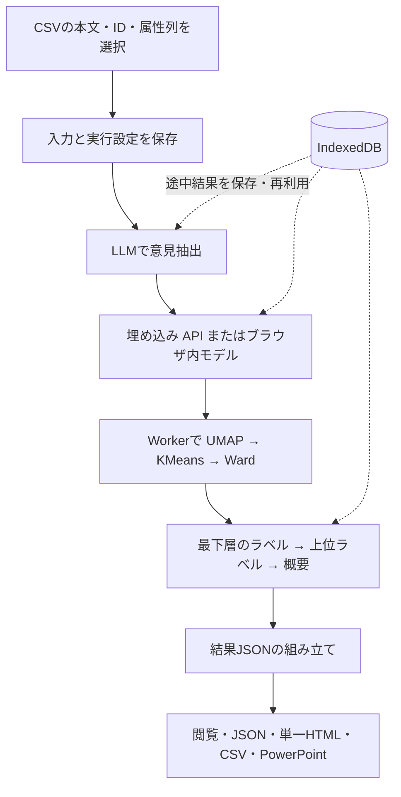

## 結論

**kouchou-ai-serverless は、広聴AI の分析処理をブラウザ用に独立して書き直した TypeScript アプリである。** Python の analysis-core を呼ぶ薄い UI ではない。通常分析のほか、保存済みデータでクラスタ数を変える画面と、賛否・話題・理由を使う独立した分析経路を持つ。

ブラウザだけで入力・計算・保存・書き出しを進められる構造は揃っている。一方、同じプロンプトや似た結果 JSON を使っていても、本体と分析の意味まで同じとはいえない。優先して揃えたいのは、元コメント本文を配布する条件、別回答の同文意見を数える単位、上位クラスタの分け方、失敗と正常な空結果の区別である。以下の現行コードと適合性テストより。

## 観測範囲と鮮度

- 調査日: 2026-11-24。org fork を `work/kouchou-ai-serverless-org/` に新規 clone し、main `d15fb57e90e49595b112a2188e086b418f355583` を読んだ。以前からある `work/kouchou-ai-serverless/` は実験ブランチなので調査の基準にしなかった。
- 本体は `work/kouchou-ai/` で fetch と fast-forward pull を実行し、main `a775d3d21ec369986028af4c9bc67feb9cbe1f59` を参照した（[[source-code]]より）。
- [org PR #1](https://github.com/digitaldemocracy2030/kouchou-ai-serverless/pull/1) は **merge 済み**。org の open PR は0件。上流 tokoroten 側は PR #48、本体側は #1227〜#1231・#1233・#1234 が open だった。これらを main の実装とは混同しない。
- 適合性テストの期待値は、本体 `3649fe417d2ee441e3475350e89ff6f4b35980e8` から作られている。今回取得した本体 main から期待値を再生成したわけではない。
- 今回はコードと GitHub の状態の調査。Slack・議事録の再取得、実 LLM・Gemini Nano・WebGPU の動作確認、利用画面の操作確認は行っていない。過去の所有・統合方針は [[serverless-integration-options-2026-11-24]] より。

## 通常分析の流れ

| 担当 | 主なファイル | 実際の責務 |
|---|---|---|
| 画面と入力 | `src/App.tsx`、`components/WizardPage.tsx`、`lib/csv.ts` | hash routing。CSVの本文・ID・属性を選び、空白行を除き、重複ID等を補正する |
| 実行管理 | `src/store/runner.ts` | Zustand で進捗・中断・完了を管理。プロジェクト作成時の接続設定を使う。Web Locks が使える場合、同一プロジェクトの別タブ実行を抑止する |
| 工程の順序 | `src/lib/pipeline/orchestrator.ts` | 抽出→埋め込み→クラスタ→初期ラベル→統合ラベル→概要→集計の固定順。Python の plugin/workflow engine は使わない |
| 意見抽出 | `src/lib/pipeline/steps/extraction.ts` | コメントごとにLLMを呼び、正常0件と失敗を区別。成功分を保存し、失敗があれば実行中の要求を待ってから中断する |
| 埋め込み | `src/lib/pipeline/steps/embedding.ts` | APIは100件、ローカルは16件ずつ。結果を `Float32Array` にする |
| 分類と座標 | `src/lib/pipeline/clusteringCore.ts`、`lib/workers/clustering.worker.ts` | `umap-js` で2次元へ、最大クラスタ数で KMeans を1回実行し、その重心を Ward でまとめて上位階層を作る |
| ラベルと概要 | `src/lib/pipeline/steps/labelling.ts`、`overview.ts` | 最下層の意見をサンプリングしてラベル付けし、子ラベルと意見から親を説明する。子が1つならラベルを引き継ぐ |
| 結果と持ち出し | `src/lib/pipeline/steps/aggregation.ts`、`lib/export.ts` | 本体の従来形式に似た `hierarchical_result.json` を生成。HTMLはビルド済みの単一ファイルのテンプレートにJSONを埋め込む |

一次参照: [orchestrator](https://github.com/digitaldemocracy2030/kouchou-ai-serverless/blob/d15fb57e90e49595b112a2188e086b418f355583/src/lib/pipeline/orchestrator.ts)、[clusteringCore](https://github.com/digitaldemocracy2030/kouchou-ai-serverless/blob/d15fb57e90e49595b112a2188e086b418f355583/src/lib/pipeline/clusteringCore.ts)、[export](https://github.com/digitaldemocracy2030/kouchou-ai-serverless/blob/d15fb57e90e49595b112a2188e086b418f355583/src/lib/export.ts)より。

## API・保存・再開

チャットと埋め込みは別の接続先・モデルを選べる。画像生成にも独立した設定がある。通常はブラウザから選択先の API へ直接アクセスするため、相手側の CORS に依存する。「serverless」は外部 API への送信がないという意味ではない。

`src/lib/llm/client.ts` は構造化出力→JSON object→プロンプト指定のフォールバック、429/5xx・ネットワークエラーの再試行、タイムアウト、AbortSignal、usage 集計を持つ。Gemini Nano は `local:gemini-nano` で専用処理へ分岐する。ブラウザ内埋め込みは Transformers.js を Worker で動かし、WebGPU が使えなければ WASM へ落とす。モデルは初回に取得する。実環境での対応可否・品質は今回未検証。[client](https://github.com/digitaldemocracy2030/kouchou-ai-serverless/blob/d15fb57e90e49595b112a2188e086b418f355583/src/lib/llm/client.ts)、[localEmbedding](https://github.com/digitaldemocracy2030/kouchou-ai-serverless/blob/d15fb57e90e49595b112a2188e086b418f355583/src/lib/llm/localEmbedding.ts)より。

保存は2段ある。`store/settings.ts` の設定は localStorage、プロジェクト・確定した工程・コメント単位の抽出・バッチ単位の埋め込み・クラスタ単位のラベル・完成レポートは Dexie/IndexedDB に置く。プロジェクトには接続設定の snapshot も入る。APIキーは設定だけでなく、このsnapshotにも保持される。結果の config は別途組み立てるため、プロジェクトのsnapshotをそのまま結果JSONに写す実装ではない。

画面遷移中は実行が続くが、タブを閉じた後も処理が継続する仕組みではない。閉じた場合は、再開時に保存済みの工程・チャンクを読み、未完了分を実行する。ブラウザ側のデータ削除や保存領域の喪失に備え、永続ストレージの要求と前処理データの書き出しもある。[runner](https://github.com/digitaldemocracy2030/kouchou-ai-serverless/blob/d15fb57e90e49595b112a2188e086b418f355583/src/store/runner.ts)、[db](https://github.com/digitaldemocracy2030/kouchou-ai-serverless/blob/d15fb57e90e49595b112a2188e086b418f355583/src/lib/storage/db.ts)、[checkpoints](https://github.com/digitaldemocracy2030/kouchou-ai-serverless/blob/d15fb57e90e49595b112a2188e086b418f355583/src/lib/storage/checkpoints.ts)より。

## 対話的再クラスタリングと賛否スペクトラム

**通常版の対話的再クラスタリング**は `components/InteractivePage.tsx` が担当する。抽出と埋め込みを再利用し、UMAPのパラメータやクラスタ数を変更できる。結果JSONから元プロジェクトを復元する経路もあり、埋め込みがなくても保存済みの2次元座標の上でクラスタ数を変えられる。ラベルと概要の生成には、キャッシュがなければLLMを使う。「操作を変えても常に無料」ではない。[InteractivePage](https://github.com/digitaldemocracy2030/kouchou-ai-serverless/blob/d15fb57e90e49595b112a2188e086b418f355583/src/components/InteractivePage.tsx)、[reportProject](https://github.com/digitaldemocracy2030/kouchou-ai-serverless/blob/d15fb57e90e49595b112a2188e086b418f355583/src/lib/reportProject.ts)より。

**賛否スペクトラム**は `src/stance-spectrum/` の別パイプラインで、通常版の抽出工程に依存しない。コメントごとの1回のLLM呼び出しで意見と賛否分布・話題・理由を一緒に取り、タグの統合表を作り、埋め込みと組み合わせて候補グラフを作る。重みを変えると辺の類似度を再計算してレイアウトへ反映する。賛否は7分類＋unknownで、単一のスコアだけで分類する実装ではない。

候補グラフの意味的近傍は Worker 内の総当たり計算で、意見数をN、埋め込み次元をDとすると主要部分は O(N²D)。画面を塞がないことと、大規模入力で速いことは別である。レイアウト後の分割には、連結制約付き Ward の併合列を指定クラスタ数で切る経路がある。通常版の KMeans→重心のWard とも、本体の `opinion_stance` とも同一ではない。[prepare](https://github.com/digitaldemocracy2030/kouchou-ai-serverless/blob/d15fb57e90e49595b112a2188e086b418f355583/src/stance-spectrum/prepare.ts)、[graph](https://github.com/digitaldemocracy2030/kouchou-ai-serverless/blob/d15fb57e90e49595b112a2188e086b418f355583/src/stance-spectrum/graph.ts)、[layout.worker](https://github.com/digitaldemocracy2030/kouchou-ai-serverless/blob/d15fb57e90e49595b112a2188e086b418f355583/src/stance-spectrum/workers/layout.worker.ts)より。

## 本体との差と利用者への影響

| 差 | 実装と影響 |
|---|---|
| 元コメントの配布条件 | serverlessの集計は元コメント本文を常に `comments` に入れ、JSON・HTML出力もそれを使う。本体はレポート単位の `enable_original_comments` で既定off。serverlessに明示選択を設けることと、本体の公開変換で外部結果にも方針を適用することは別の作業 |
| 同文意見と属性 | serverlessの抽出は文面だけで重複をまとめ、集計は最初の回答のID・属性を採用する。たとえば属性の違う2回答がともに「バスを増やして」となった場合、点が1つになり、後の回答の属性はその点に反映されない。本体は `(comment_id, 文面)` ごとに保持する |
| Ward法 | serverlessの `agnes(..., {method: "ward"})` と本体の scipy ward で統合結果が異なる。固定重心7ケースでは現行wardが5件一致、ward2が7件一致。ただし番号の付け方、KMeans、UMAPの違いまでは解消しない |
| ラベルの失敗 | 通常版のラベル付けは失敗をプレースホルダに置き換え、キャッシュして続ける。本体は工程を失敗にする。再実行しても同一構成のキャッシュが優先されるため、APIの回復だけでは正常ラベルへ戻らない場合がある |
| 概要の形式不正 | `summary` がないJSONや途中で切れたJSONを、そのまま概要の文字列として採用しうる。本体は失敗にする |
| 賛否スペクトラム側の抽出失敗 | `extractEnrichOne()` は中断以外の例外を `[]` にし、呼び出し側がそれをキャッシュする。ほかに意見があれば続行する。通常版の「抽出失敗を正常0件と区別する」改善は、この経路には及んでいない |
| 結果契約 | serverlessの書き出しは従来形式の `hierarchical_result.json`。本体の `public_result.json` の `schema_version: 1` とホワイトリスト変換は未実装。数字のIDの型、propertyMap、コメント数の数え方にも差がある |

通常版の既知の差22項目は [known-divergences.json](https://github.com/digitaldemocracy2030/kouchou-ai-serverless/blob/d15fb57e90e49595b112a2188e086b418f355583/conformance/known-divergences.json)より。抽出・集計の実際の経路は [extraction](https://github.com/digitaldemocracy2030/kouchou-ai-serverless/blob/d15fb57e90e49595b112a2188e086b418f355583/src/lib/pipeline/steps/extraction.ts)、[aggregation](https://github.com/digitaldemocracy2030/kouchou-ai-serverless/blob/d15fb57e90e49595b112a2188e086b418f355583/src/lib/pipeline/steps/aggregation.ts)、[labelling](https://github.com/digitaldemocracy2030/kouchou-ai-serverless/blob/d15fb57e90e49595b112a2188e086b418f355583/src/lib/pipeline/steps/labelling.ts)、[extractEnrich](https://github.com/digitaldemocracy2030/kouchou-ai-serverless/blob/d15fb57e90e49595b112a2188e086b418f355583/src/stance-spectrum/extractEnrich.ts)で照合した。本体の比較先は [extraction](https://github.com/digitaldemocracy2030/kouchou-ai/blob/a775d3d21ec369986028af4c9bc67feb9cbe1f59/packages/analysis-core/src/analysis_core/steps/extraction.py)、[public_result](https://github.com/digitaldemocracy2030/kouchou-ai/blob/a775d3d21ec369986028af4c9bc67feb9cbe1f59/packages/analysis-core/src/analysis_core/public_result.py)より。

本体にある LLM 直接グルーピング、意見分類・新規性、翻訳、Python plugin も、この通常分析パイプラインの移植範囲には含まれていない。[適合性テストの範囲](https://github.com/digitaldemocracy2030/kouchou-ai-serverless/blob/d15fb57e90e49595b112a2188e086b418f355583/conformance/README.md)より。

## 検証の読み方

適合性テストは、固定入力と偽のLLM応答で、本体由来の期待値と照合する。既知の22項目は `it.fails` で「不一致であること」を検査する。したがって通常のテストが全件成功しても、両版が完全一致したことにはならない。登録した差が解消した際には一覧から外す必要がある。

埋め込み、UMAP座標、実LLMの品質、ラベルの部分サンプリングは一致の対象外。賛否スペクトラムも比較対象外である。週次の期待値の古さの検査は用意されているが、今回実行していない。[conformance/README](https://github.com/digitaldemocracy2030/kouchou-ai-serverless/blob/d15fb57e90e49595b112a2188e086b418f355583/conformance/README.md)、[harness](https://github.com/digitaldemocracy2030/kouchou-ai-serverless/blob/d15fb57e90e49595b112a2188e086b418f355583/tests/conformance/harness.ts)より。

今回、lockfileどおりの依存とNode 24.22.3 / pnpm 10.24.0で実行し、通常成功253件・expected fail 22件（計275件、23ファイル）を確認した。`pnpm lint`、`pnpm build`も成功。buildには静的・動的importの重複に関する警告がある。手元のNode 20.10.0ではツールの起動に失敗したため、新しいNodeで依存を入れ直している。アプリのテスト失敗とは区別する。

追加の偽APIによる小さい再現では、ラベル生成を401で失敗させた後、正常応答へ切り替えて同じ構成を再実行してもAPIは呼ばれず、プレースホルダが戻った。賛否スペクトラムでは2回答のうち片方だけを401にすると、正常な片方の意見だけで処理が戻り、失敗した回答は `[]` として保存された。同じチェックポイントでの再実行にもAPI呼び出しはなかった。どちらも実APIや課金を使わず、メモリのチェックポイントで工程関数を確認したもので、画面からの復帰操作は未検証。スクリプト・出力・テストとbuildのログは `raw/serverless-implementation-2026-11-24/` に保存した。

## 次の実装順の案

1. **配布の契約**: 元コメント本文の明示選択と `public_result.json` の出力を揃える。従来の全部入り結果と公開用結果を分ける。
2. **回答と意見の対応**: 本体に合わせて回答単位に保持するか、多対多を明示するかを決める。文面の統合だけ先に行い、属性を初出に寄せる状態を避ける。
3. **失敗からの復帰**: 通常版のラベル・概要、賛否スペクトラムの抽出を確認し、失敗結果を成功のキャッシュとして残さない。
4. **分類の差**: ward2を候補として比較する。番号の違いは分割の違いと分けて扱い、UMAP・KMeansを含む結果全体の品質は別の実験で評価する。

これは調査からの提案で、コード修正やIssueの担当引受は行っていない。方針上の本流化は [#921](https://github.com/digitaldemocracy2030/kouchou-ai/issues/921) のopen状態と別に判断する。

## Open Questions

- 異なる回答の同文意見を別々に保持するか、多対多の束にするか。本体 [#1156](https://github.com/digitaldemocracy2030/kouchou-ai/issues/1156) の契約とも合わせる必要がある。
- 寛容な応答パースのうち、残す利便性と、公開を止めるべき不正データの境界をどう決めるか。
- 賛否スペクトラムを公式に保守する範囲、想定入力規模、受け入れ条件をどう置くか。

## Updates

- **2026-11-25（本体に実装し PR 提出）**。[親 Issue #1261](https://github.com/digitaldemocracy2030/kouchou-ai/issues/1261) の下に3件を紐付けた。PowerPoint は [Issue #1264 / PR #1268](https://github.com/digitaldemocracy2030/kouchou-ai/pull/1268)、ポンチ絵は [Issue #1262 / PR #1266](https://github.com/digitaldemocracy2030/kouchou-ai/pull/1266)、対話的な再クラスタリングと賛否の探索は [Issue #1263 / PR #1267](https://github.com/digitaldemocracy2030/kouchou-ai/pull/1267)。提出時点では未マージ。
  - 管理画面で論点別のリンクと任意の表紙画像付き PPTX を出力し、公開ビューアで該当の論点を開く。ポンチ絵は画像 API の明示実行後に確認して PNG で取得する。両操作は Chrome とダミー API で確認し、実画像 API は未実施。
  - 探索は公開ビューアで保存済み散布図の座標を維持し、公開済みの賛否スコア・話題や理由として選べる属性を重み付けする。共有 URL から操作を再現した。ブラウザ版の新規スコア推定や再配置とは処理経路が異なる。

- **2026-11-25（優先順位の案）**。サーバ版で作ったレポートを会議で説明する人が、同じ結果から編集可能な PowerPoint を作り、スライドの論点と件数を公開レポートで確かめられるようにする。まず、すでにある結果 JSON の読み込みと PowerPoint 出力を使い、公開レポート 1 件で、資料を作る人が修正した箇所と元の意見に戻れたかを確認する。使われるなら、サーバ版の結果画面からも同じ書き出しを使えるようにする。[JSON の読み込み](https://github.com/digitaldemocracy2030/kouchou-ai-serverless/blob/14a547d240a5601b6f19c9ab3cba2b32402c121e/src/components/HomePage.tsx#L91-L99)・[[long-term-strategy-2026-11-02]]より。
  - ポンチ絵は確認して採用する任意の表紙にし、件数・論点・参照先は編集できる要素として結果から入れる。現状の通常レポート用プロンプトは概要・上位ラベルを渡し、対立がある場合の左右配置を指示している。賛否や論点間の関係を図に示す場合は、レポート上で対応する証拠を確認できるものに限る案。[現行の画像プロンプト](https://github.com/digitaldemocracy2030/kouchou-ai-serverless/blob/14a547d240a5601b6f19c9ab3cba2b32402c121e/src/lib/imageGen.ts#L21-L52)より。
  - 再クラスタリングと賛否スペクトラムはブラウザ版で探索に使い、説明に採用した切り方だけを元レポートと関連付けて共有・再表示できるようにする。ブラウザ内モデルは設定や環境に応じて使える経路として育てる。共通の受け渡しには公開 JSON の件数・出典・公開範囲を使う。[[embedding-public-results]]より。

- **2026-11-25（利用者向けの機能差を確認）**。org のブラウザ版 `14a547d2` とサーバ版 `03d07295` の main、および両 repo の open PR を照合した。以下は標準 UI と同梱機能のコード比較。実画像 API での再生成は今回未実施。
  - **ポンチ絵**。通常レポートの概要と上位クラスタ名から画像生成 API で争点の概念図を作れる。賛否スペクトラムでも現在のクラスタ構成・件数・賛否内訳から生成できる。新規生成には画像プロバイダ設定が要り、通常レポートのサンプルには生成済み画像がある。サーバ版標準の生成機能は確認できなかった。[通常レポート](https://github.com/digitaldemocracy2030/kouchou-ai-serverless/blob/14a547d240a5601b6f19c9ab3cba2b32402c121e/src/components/ViewerPage.tsx#L278-L307)・[賛否スペクトラム](https://github.com/digitaldemocracy2030/kouchou-ai-serverless/blob/14a547d240a5601b6f19c9ab3cba2b32402c121e/src/components/StanceSpectrumPage.tsx#L975-L1017)・[同梱サンプル](https://github.com/digitaldemocracy2030/kouchou-ai-serverless/blob/14a547d240a5601b6f19c9ab3cba2b32402c121e/src/lib/sampleReport.ts#L18-L33)より。
  - **PowerPoint 書き出し**。通常レポートを `.pptx` にし、生成済みのポンチ絵を表紙に入れられる。単一 HTML にもポンチ絵を同梱する。サーバ版の管理画面には静的 HTML 書き出しがあり、両版でレポートの HTML 化はできる。[ブラウザ版の書き出し](https://github.com/digitaldemocracy2030/kouchou-ai-serverless/blob/14a547d240a5601b6f19c9ab3cba2b32402c121e/src/components/ViewerPage.tsx#L131-L175)・[サーバ版の書き出し](https://github.com/digitaldemocracy2030/kouchou-ai/blob/03d0729524ff5b8b3d3fc797a5dab98308032521/apps/admin/app/_components/ReportCard/ActionMenu/ActionMenu.tsx#L192-L206)より。
  - **対話的な切り直し**。通常分析では保存済みの埋め込みや対応する結果 JSON の座標からクラスタ数をスライダーで変える。賛否スペクトラムでは賛否・話題・理由の重みで散布図とグループを変える。サーバ版にあるのは CLI で付けた意見別賛否スコアの絞り込みで、公開ビューアに事前計算済み対立軸を表示する [PR #1249](https://github.com/digitaldemocracy2030/kouchou-ai/pull/1249) は確認時点で未マージ。[ブラウザ版 README](https://github.com/digitaldemocracy2030/kouchou-ai-serverless/blob/14a547d240a5601b6f19c9ab3cba2b32402c121e/README.md)・[サーバ版 CLI ガイド](https://github.com/digitaldemocracy2030/kouchou-ai/blob/03d0729524ff5b8b3d3fc797a5dab98308032521/docs/user-guide/cli-quickstart.md#L430-L449)より。
  - **ブラウザ内モデル**。対応環境では Chrome 内蔵 Gemini Nano とブラウザ内の埋め込みモデルを選べる。サーバ版もローカル LLM に接続できるが、このブラウザ内実行はサーバレス版の経路。[ブラウザ版 README](https://github.com/digitaldemocracy2030/kouchou-ai-serverless/blob/14a547d240a5601b6f19c9ab3cba2b32402c121e/README.md)・[[llm-providers]]より。

- 2026-11-24（残る10項目の調査）: [[serverless-remaining-divergences-2026-11-24]]に、維持する差と直すべき問題を整理した。優先は、JSON補正が引用符内の意見本文を変更する問題と、原文なしJSONを再クラスタリングすると属性・意見ごとの数値・元の件数が失われる問題。前回の検証では公開JSONの受け渡し後の再分析を扱っていなかった。今回は調査のみでコード変更なし。
- 2026-11-24（merge完了）: ユーザーの「CI通ったらmergeしていい」という承認を受け、最終head `ae9a0b72` のCI全成功・merge可能・未解決レビューなしを確認して [PR #2](https://github.com/digitaldemocracy2030/kouchou-ai-serverless/pull/2) をsquash mergeした。org mainは `234123512681e686ece4f86ebaac6085f107a04e`。merge後のmainでも検査は成功し、local cloneもmainへ追従した。下の「未merge」はPR作成時点の記録。既知の差10項目と実LLM品質の確認は引き続き別に残る。
- 2026-11-24（修正PR作成）: ユーザーの指示で org の [PR #2](https://github.com/digitaldemocracy2030/kouchou-ai-serverless/pull/2)（`codex/serverless-correctness-and-public-output`、`04594d12`）を作成した。**未mergeであり、上のmain観測は修正前の記録**。
  - 通常版・賛否スペクトラムとも回答単位で同文意見を保持し、comment_idを文字列に統一。通常版の上位クラスタはward2へ変更した。固定重心7ケースの分割が本体と一致し、番号等の差は一覧に残した。
  - ラベル・概要の失敗と、賛否スペクトラムの抽出失敗を成功キャッシュとして保存しない。並列処理を待ってから失敗を返し、成功分だけを再利用して再試行する。旧プレースホルダ・未確認の空配列も取り直す。
  - 元コメント本文は作成時の明示opt-in（既定OFF）にし、旧JSONも書き出し時に同じ方針を適用。JSONと単一HTMLは公開フィールドの変換を通す。JSONのファイル名はpublic_result.json（schema_version=1）に変更した。HTMLのタイトルは表示用メタデータへ分離した。
  - 完了済み工程の入力・世代キーで旧結果との混在を防ぐ。旧前処理ファイルの回答横断の対応は、元のベクトルを複製して復元する（LLM不要）。完成済みレポートは変更しない。前処理ファイルは元コメント・埋め込みを含む作業用データとして扱う。
  - Node 24.22.3 / pnpm 10.24.0で通常成功292件・既知不一致10件（計302件）、lint・build成功。Chromiumで元コメントの既定OFF・明示ON、JSON/HTML書き出し、HTML単体表示、旧工程キャッシュ拒否を確認し、ページのJavaScriptエラーなし。実LLMの品質は未検証。証跡は `raw/serverless-fixes-2026-11-24/`。
  - 同日のCI確認: PR #2のlint・test・buildと、本体の記録済みcommitから期待値を再生成して一致させる検査は成功。PRはopen・merge可能で未merge。本体mainの期待値との週次比較は今回のCI対象外。
- 2026-11-24: 初版。org mainと本体mainのコード・open PR・#921を観測し、Wardの固定7ケースを追加確認した。raw/workの元コメントや実行設定は公開Wikiへ転記していない。
